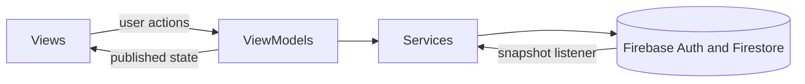

# TodoApp

A to-do list app for iOS built with **SwiftUI**, **Firebase Authentication** and **Cloud Firestore**. Each user signs in with an email and password and sees only their own tasks, which update in real time across devices.

## Table of contents

- [Features](#features)
- [Tech stack](#tech-stack)
- [Architecture](#architecture)
- [Project structure](#project-structure)
- [Getting started](#getting-started)
- [Data model](#data-model)
- [Security rules](#security-rules)
- [How the app works](#how-the-app-works)
- [Testing checklist](#testing-checklist)
- [Troubleshooting](#troubleshooting)
- [Roadmap](#roadmap)
- [Contributing](#contributing)

## Features

**Authentication**
- Sign up, sign in, sign out and password reset by email
- Session persists between launches (no login screen flash on startup)
- Input validation: email format, password of at least 6 characters, confirm password on sign up
- Friendly error messages for invalid email, wrong password, weak password, email already in use and network errors

**Tasks**
- Create, edit, complete and delete tasks (full CRUD)
- Real-time updates through a Firestore snapshot listener
- Newest tasks first
- Swipe left to delete, tap the circle to toggle completion, tap the text to edit
- Completed tasks are shown with a strikethrough
- Empty state with an Add Task button
- Title is required; description is optional

**Quality**
- Per-user data isolation enforced by Firestore security rules
- Dark mode and Dynamic Type support
- Accessibility labels on all interactive elements
- SwiftUI previews for every view, with no Firebase connection needed

## Tech stack

| Area | Choice |
| --- | --- |
| Language | Swift 5.9+ |
| UI | SwiftUI (`NavigationStack`, `ContentUnavailableView`) |
| Architecture | MVVM with `async/await` |
| Authentication | Firebase Authentication (email and password) |
| Database | Cloud Firestore |
| Dependencies | `firebase-ios-sdk` via Swift Package Manager (`FirebaseAuth`, `FirebaseFirestore`) |
| Minimum OS | iOS 17.0 |
| Tools | Xcode 15 or later |

No Combine is used beyond `ObservableObject` and `@Published`, and `FirebaseFirestoreSwift` is not needed because Codable support is built into the current SDK.

## Architecture

The app uses MVVM with a separate service layer. Views never talk to Firebase directly.



| Layer | Responsibility |
| --- | --- |
| **Model** | `TodoTask`, a `Codable` struct mapped to a Firestore document |
| **Services** | `AuthService` and `TaskService` wrap Firebase calls. They hold no UI state |
| **ViewModels** | `AuthViewModel` and `TaskViewModel` hold state, validate input and expose actions. Both are `@MainActor` |
| **Views** | SwiftUI screens that render state and forward actions |

Key decisions:

- `AuthViewModel` is created once in `TodoApp` and shared with `@EnvironmentObject`.
- `TaskViewModel` is created per signed-in user inside `TaskListView`. `RootView` applies `.id(uid)` so a different user always gets a fresh list and a fresh listener.
- Both services use a `lazy` Firebase handle, and both ViewModels accept preview data, so SwiftUI previews never touch Firebase.
- The task listener is removed when the list disappears and on sign out.

## Project structure

```
TodoApp/
├── TodoApp.swift                 Entry point, Firebase config, auth routing (RootView)
├── Models/
│   └── TodoTask.swift
├── Services/
│   ├── AuthService.swift         Firebase Auth wrapper and error mapping
│   └── TaskService.swift         Firestore reads and writes
├── ViewModels/
│   ├── AuthViewModel.swift       Auth state, validation (AuthValidator)
│   └── TaskViewModel.swift       Task list state and actions
└── Views/
    ├── Auth/
    │   ├── LoginView.swift
    │   ├── SignUpView.swift
    │   └── ForgotPasswordView.swift
    ├── Tasks/
    │   ├── TaskListView.swift
    │   ├── TaskRowView.swift
    │   └── TaskFormView.swift    Used for both add and edit
    └── Components/
        ├── AuthTextField.swift   Styled field with show/hide password
        ├── PrimaryButton.swift
        ├── LoadingOverlay.swift
        └── MessageAlert.swift

firestore.rules                   Production security rules
commit.md                         Commit message conventions
```

## Getting started

### Prerequisites

- A Mac with **Xcode 15 or later**
- An iOS 17+ simulator or device
- A free Google account for Firebase

### 1. Create the Xcode project

1. In Xcode choose **File → New → Project → iOS → App**.
2. Set **Product Name** to `TodoApp`, **Interface** to SwiftUI, **Language** to Swift and **Storage** to None.
3. Set **Minimum Deployments** to iOS 17.0 (target → General).
4. Delete the generated `TodoApp.swift` and `ContentView.swift`.
5. Drag the source files from this repository into the project's `TodoApp` group. Tick **Copy items if needed**, **Create groups** and your app target.
6. Note your **Bundle Identifier** (target → Signing & Capabilities). For example `com.yourname.TodoApp`.

### 2. Create the Firebase project

1. Open the [Firebase console](https://console.firebase.google.com) and click **Add project**.
2. Name it `TodoApp`. Google Analytics is optional.
3. Click the **iOS+** icon, paste your exact bundle ID and click **Register app**.
4. Download `GoogleService-Info.plist`.
5. Drag it into the `TodoApp` group in Xcode, next to `TodoApp.swift`. Make sure the app target is ticked.

> `GoogleService-Info.plist` is specific to your Firebase project. It is not included in this repository.

### 3. Add the Firebase SDK

1. In Xcode choose **File → Add Package Dependencies…**
2. Enter `https://github.com/firebase/firebase-ios-sdk` and keep the default version rule.
3. Add **only** `FirebaseAuth` and `FirebaseFirestore`.

### 4. Enable sign-in and the database

1. In the Firebase console go to **Build → Authentication → Sign-in method** and enable **Email/Password**.
2. Go to **Build → Firestore Database → Create database**, choose a location near you and start in **test mode**.
3. Open the **Rules** tab, paste the contents of [`firestore.rules`](firestore.rules) and click **Publish**.

> Test mode lets anyone read and write for 30 days. Publish the rules in step 3 before sharing the app with anyone.

### 5. Run

Choose an iPhone simulator running iOS 17 or later and press **⌘R**. Sign up with any email and a password of at least 6 characters, then add your first task.

To confirm the connection, check that the new user appears under **Authentication → Users** and your tasks appear under **Firestore Database → Data**.

## Data model

Tasks are stored per user at:

```
users/{uid}/tasks/{taskId}
```

| Field | Type | Notes |
| --- | --- | --- |
| `title` | string | Required, 1 to 200 characters |
| `description` | string | Optional, empty string when not set, up to 5000 characters |
| `isCompleted` | bool | `false` when created |
| `createdAt` | timestamp | Set by the server on creation |
| `updatedAt` | timestamp | Set by the server on every update |
| `userId` | string | Owner's Firebase Auth uid, never changes |

The document ID is not stored as a field. `@DocumentID` fills `TodoTask.id` from it.

Server timestamps keep ordering correct even if a phone's clock is wrong. A task you just created can show an empty `createdAt` for a moment until the server confirms it.

## Security rules

The rules in [`firestore.rules`](firestore.rules) make sure that:

- Only a signed-in user can access data, and only under `users/<their own uid>/tasks`.
- Everything outside that path is denied by default.
- Task writes must have a valid title, description and `isCompleted` value.
- The `userId` field must match the path on create and cannot be changed on update.

```
rules_version = '2';
service cloud.firestore {
  match /databases/{database}/documents {

    function isOwner(userId) {
      return request.auth != null && request.auth.uid == userId;
    }

    function isValidTask(data) {
      return data.title is string
          && data.title.size() > 0
          && data.title.size() <= 200
          && data.description is string
          && data.description.size() <= 5000
          && data.isCompleted is bool;
    }

    match /users/{userId}/tasks/{taskId} {
      allow read: if isOwner(userId);

      allow create: if isOwner(userId)
                    && isValidTask(request.resource.data)
                    && request.resource.data.userId == userId;

      allow update: if isOwner(userId)
                    && isValidTask(request.resource.data)
                    && request.resource.data.userId == resource.data.userId;

      allow delete: if isOwner(userId);
    }
  }
}
```

If you add fields to the model, also add them to `isValidTask`, or writes with the new fields pass without validation.

You can test the rules without the app in the console under **Firestore → Rules → Rules Playground**.

## How the app works

**Launch.** `AppDelegate` calls `FirebaseApp.configure()`. `AuthViewModel` registers an auth state listener. Until Firebase reports the saved session, `RootView` shows a spinner, so a signed-in user never sees the login screen flash.

**Routing.** `RootView` shows the login flow when there is no user, and `TaskListView` for the signed-in user.

**Tasks.** `TaskViewModel` starts a Firestore snapshot listener ordered by `createdAt` descending. Every change, including your own local writes, arrives through that listener, so the view models never refresh the list by hand.

**Errors.** Firebase errors are mapped to short messages in `AuthService.friendlyMessage(for:)`. Alerts are attached in three places: `RootView` for auth errors, the task list for list errors, and the task form for save errors, so two alerts never compete.

**Offline.** Firestore's offline persistence is on by default. Loaded tasks stay readable offline, and writes made offline are queued and synced when the connection returns. Note that the update, toggle and delete calls are awaited, so they finish only after the server confirms.

## Testing checklist

**Authentication**
- [ ] An invalid email shows a hint and Sign In stays disabled
- [ ] A password under 6 characters shows a hint
- [ ] Sign up with mismatched passwords is blocked
- [ ] Sign up with a new email works and opens the task list
- [ ] Sign up with an existing email shows "An account with this email already exists."
- [ ] A wrong password shows "Incorrect email or password."
- [ ] Forgot password shows the success alert and the email arrives (check spam)
- [ ] Sign out returns to login, and relaunching while signed in skips login

**Tasks**
- [ ] The empty state shows for a new account
- [ ] Save is disabled while the title is empty
- [ ] A task with only a title saves, and so does one with a description
- [ ] The newest task appears first
- [ ] Toggling shows a green check and a strikethrough, and toggles back
- [ ] Tapping a task opens the editor, Save updates it and Cancel discards changes
- [ ] Swiping left deletes a task
- [ ] Editing a task in the Firebase console updates the app live

**Security**
- [ ] A second account never sees the first account's tasks
- [ ] Rules Playground denies other users and unauthenticated requests
- [ ] Test mode has been replaced by the published rules

**Quality**
- [ ] Dark mode looks right
- [ ] The largest Dynamic Type sizes do not clip text
- [ ] VoiceOver reads the buttons sensibly
- [ ] Every SwiftUI preview renders without crashing

## Troubleshooting

| Symptom | Cause and fix |
| --- | --- |
| `No such module 'FirebaseCore'` | Packages are still resolving. Wait, or use **File → Packages → Resolve Package Versions**, then clean with **⇧⌘K** |
| Crash: "Could not locate configuration file GoogleService-Info.plist" | The plist is not in the target. Select it, open the File Inspector and tick the app under Target Membership |
| "The default Firebase app has not been configured" in a preview | Use `AuthViewModel(startListening: false)` and `TaskViewModel(userId:previewTasks:)` in previews |
| "Missing or insufficient permissions" | You are not signed in, the path is wrong, or the rules are not published |
| Sign up fails with a generic error | Email/Password sign-in is not enabled in the Firebase console |
| Network error alert | No internet connection. Check the Mac's connection or restart the simulator |
| Edit sheet's Save stays disabled while offline | Expected. The save is awaited until the server confirms, and it completes when you are back online |
| Old tasks flash after switching accounts | Keep `.id(uid)` on `TaskListView` in `RootView` |
| Problems after changing the bundle ID | Register the app again in Firebase and replace `GoogleService-Info.plist` |
| Build errors after an SDK update | Check the Firebase release notes. This code targets recent 10.x and 11.x SDKs |

## Roadmap

- [ ] Search bar and an All / Active / Completed filter
- [ ] Due date and priority fields
- [ ] Pull to refresh
- [ ] Unit tests for `AuthViewModel` and `TaskViewModel`
- [ ] Sign in with Apple
- [ ] Drag to reorder tasks

## Contributing

Commits follow the [Conventional Commits](https://www.conventionalcommits.org/en/v1.0.0/) specification. See [`commit.md`](commit.md) for the accepted types, scopes and examples.

A short workflow:

1. Create a branch from `main`.
2. Make small, focused commits with messages like `feat(tasks): add swipe to delete on task rows`.
3. Run through the relevant parts of the [testing checklist](#testing-checklist).
4. Open a pull request describing what changed and why.

Do not commit `GoogleService-Info.plist` to a public repository, and do not commit `xcuserdata/`, `DerivedData/` or `.DS_Store`.
